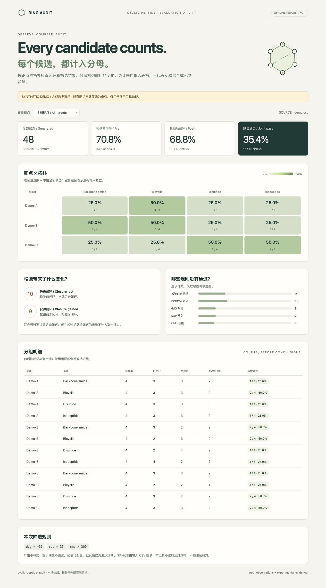

# cyclic-peptide-audit

A small Python CLI for auditing cyclic peptide candidate tables: compare closure status before and after relaxation, apply explicit score rules, and summarize results by target and topology.

一个轻量 Python 命令行工具：比较环肽候选在松弛前后的闭环状态，应用明确的分数筛选规则，并按靶点与拓扑汇总结果。

**Scope / 适用范围:** this tool audits values supplied in a CSV. It does not inspect 3D structures, validate chemical bonds, predict binding affinity, or provide experimental evidence. The bundled data are entirely synthetic.

**本工具只审核 CSV 中提供的值**，不检查三维结构、不验证化学键、不预测结合力，也不提供实验验证。附带数据完全由人工合成。



*Preview uses synthetic data only. / 上图仅使用合成演示数据。*

## Quick start / 快速开始

Requires Python 3.10 or newer. Uses only the Python standard library; no third-party packages are required. Run from the repository root:

需要 Python 3.10 或更高版本，仅使用标准库，无需第三方依赖。在仓库根目录运行：

```bash
python -m peptide_audit examples/demo.csv --out report --demo
```

Open `report/index.html` in a browser. The same run also writes `report/summary.csv` and `report/audit.json` for further analysis. `--demo` visibly labels the report as a synthetic demo; omit this flag when auditing your own non-demo data.

用浏览器打开 `report/index.html` 查看报告；同一次运行还会输出用于后续分析的 `report/summary.csv` 和 `report/audit.json`。`--demo` 会在报告中醒目标注合成演示；审核自己的非演示数据时不传此标志。

Existing report files are preserved unless `--force` is specified. / 默认不覆盖已有报告；如需替换，请加 `--force`。

To change the screening rules / 修改筛选规则：

```bash
python -m peptide_audit examples/demo.csv --out report --demo --force --ddg-max -40 --sap-max 30 --cms-min 350
```

The default rules are **`ddg < -35`, `sap < 35`, and `cms > 300`**. All comparisons are strict: a value exactly on its threshold fails. These are demonstration rules, not universal scientific cutoffs or a binding prediction.

默认规则为 **`ddg < -35`、`sap < 35`、`cms > 300`**。比较均为严格不等式，等于阈值也不通过。这些只是演示筛选规则，不是普适科学阈值，也不代表结合力预测。

## Input / 输入

Each row represents one generated candidate. Required columns / 每行代表一个生成候选，必须包含以下列：

| Column / 列 | Meaning / 含义 |
| --- | --- |
| `candidate_id` | Candidate identifier, unique within a target / 候选编号，在同一靶点内唯一 |
| `target` | Target label / 靶点标签 |
| `topology` | Topology label used for grouping / 用于分组的拓扑标签 |
| `pre_closure` | Closure status before relaxation: `true` or `false` / 松弛前是否闭环 |
| `post_closure` | Closure status after relaxation: `true` or `false` / 松弛后是否闭环 |
| `ddg` | Supplied interface score; lower values pass the configured rule / 输入的界面分数，按配置检查是否低于阈值 |
| `sap` | Supplied surface aggregation score; lower values pass / 输入的表面聚集分数，按配置检查是否低于阈值 |
| `cms` | Supplied contact surface value; higher values pass / 输入的接触表面值，按配置检查是否高于阈值 |

The CLI rejects malformed input, missing required values, non-finite numbers such as `NaN` or infinity, and duplicate `(target, candidate_id)` pairs. Supply comparable scores with consistent definitions and units. The tool does not infer their provenance or recalibrate them.

工具会拒绝格式错误、必填值缺失、`NaN` 或无穷大等非有限数值，以及重复的 `(target, candidate_id)`。请使用定义和单位一致、可比较的分数；工具不会推断分数来源或重新标定分数。

## Reading the report / 理解报告

Results are grouped by **target × topology**. Every rate uses **all rows in that group** as its denominator, including candidates that failed closure or score rules.

结果按 **靶点 × 拓扑** 分组。所有比例的分母都是**该组的全部候选**，包括闭环或分数规则不通过的候选。

| Metric / 指标 | Definition / 定义 |
| --- | --- |
| `pre` | `pre_closure` is true / 松弛前闭环 |
| `post` | `post_closure` is true / 松弛后闭环 |
| `both` | Both closure flags are true / 松弛前后均闭环 |
| `joint` | `both` plus all three score rules / 前后均闭环，且三项分数规则全部通过 |
| `relax_lost` | Pre true, post false / 松弛前闭环、松弛后失去闭环 |
| `relax_gained` | Pre false, post true / 松弛前未闭环、松弛后闭环 |

A candidate with `relax_gained` does not pass `both` or `joint`. Failure reasons can overlap: one candidate may fail several checks, so failure counts must not be added as if they were mutually exclusive.

`relax_gained` 候选仍不满足 `both` 或 `joint`。失败原因可能重叠：同一候选可以同时不满足多项检查，因此不能把各失败计数直接相加当作失败总数。

## Demo data / 演示数据

`examples/demo.csv` contains 48 **synthetic** candidates: three fictional targets (`Demo-A`, `Demo-B`, `Demo-C`), four topology labels, and four candidates per target–topology group. IDs begin with `SYNTH-`. The example includes closure loss and gain, overlapping score failures, and exact-threshold values. It contains no real sequences, structures, model outputs, or experimental measurements.

`examples/demo.csv` 包含 48 条**完全合成**候选：3 个虚构靶点、4 种拓扑标签，每组 4 条。编号以 `SYNTH-` 开头，涵盖闭环丢失与获得、多项分数同时失败、恰好等于阈值等情况，不包含真实序列、结构、模型输出或实验测量。

## Development / 开发检查

```bash
python -m unittest discover -s tests -v
```

Tests cover parsing errors, non-finite values, duplicate IDs, exact-threshold behavior, denominators, and relaxation transitions. Reports are self-contained and use no external scripts or network requests. The CLI runs locally; the report contains your target labels and aggregate results, so choose deliberately which reports to share.

测试覆盖输入错误、非有限数值、重复编号、阈值边界、统计分母和松弛前后变化。报告是独立 HTML，不加载外部脚本或网络资源。工具在本地运行，报告包含输入的靶点标签和汇总结果。
